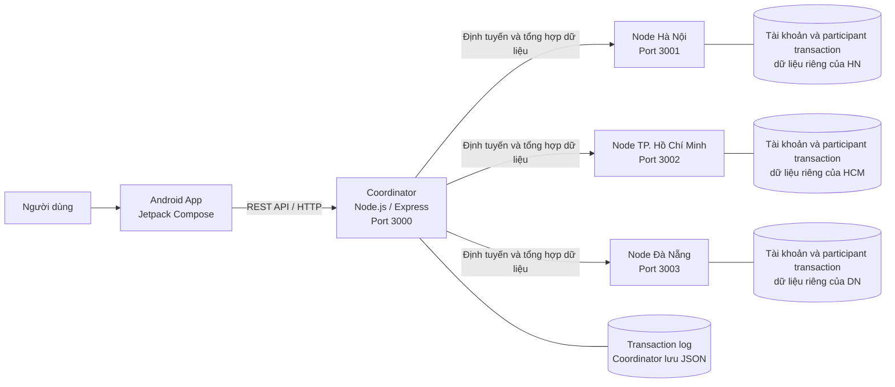
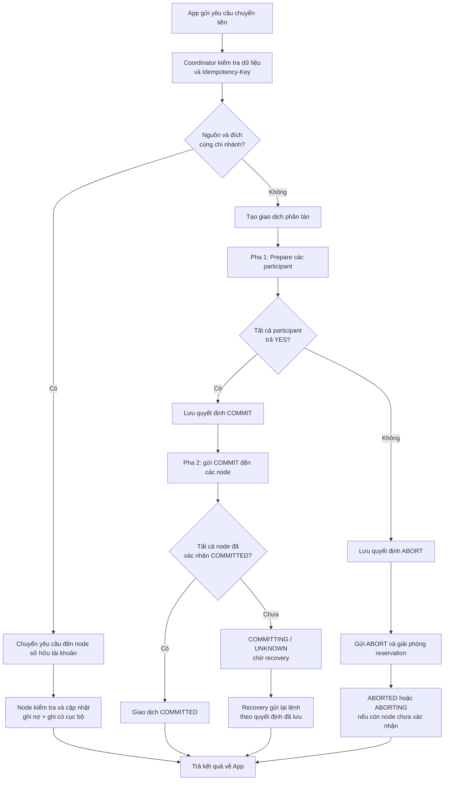
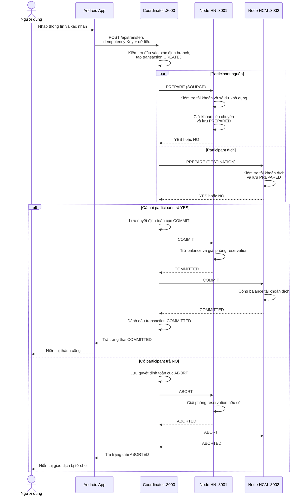
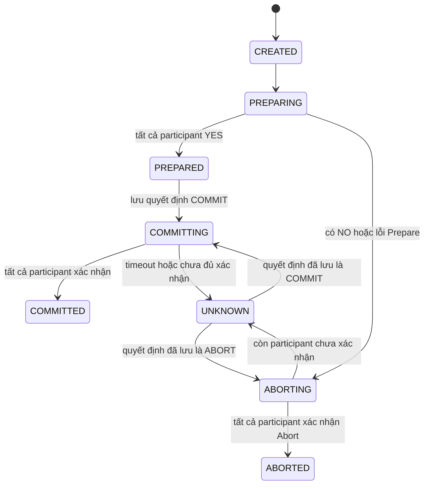

# Kiến trúc và luồng xử lý chuyển tiền liên chi nhánh

Tài liệu này trình bày kiến trúc, luồng dữ liệu và cách hệ thống xử lý giao dịch chuyển tiền giữa các chi nhánh. Các sơ đồ Mermaid có thể được render trong Markdown preview hoặc chuyển thành hình để đưa vào slide.

## 1. Bài toán cần giải quyết

Mỗi chi nhánh quản lý dữ liệu tài khoản riêng. Khi chuyển tiền liên chi nhánh, hệ thống phải cập nhật hai nơi: trừ tiền ở chi nhánh nguồn và cộng tiền ở chi nhánh đích. Nếu một nơi cập nhật được nhưng nơi kia lỗi, số liệu có thể không nhất quán.

Hệ thống cần:

- Đảm bảo giao dịch chỉ hoàn tất khi các chi nhánh tham gia cùng đồng ý.
- Ngăn khoản tiền đang chuyển bị sử dụng cho giao dịch khác.
- Xử lý participant từ chối, timeout hoặc mất kết nối.
- Cho phép phục hồi giao dịch bị gián đoạn và chống xử lý lặp khi client retry.

Giải pháp minh họa trong dự án là Two-Phase Commit (2PC), kết hợp reservation, transaction log, idempotency key và recovery.

## 2. Kiến trúc hệ thống



### Vai trò các thành phần

- **Android App:** nhập giao dịch, gọi API và hiển thị trạng thái như đang xử lý, thành công, bị hủy hoặc chờ recovery.
- **Coordinator:** nhận yêu cầu, xác định chi nhánh sở hữu tài khoản, tạo transaction record và điều phối Prepare/Commit/Abort.
- **Branch Node:** mỗi node sở hữu tài khoản của chi nhánh mình và chỉ cập nhật dữ liệu cục bộ.
- **Lưu trữ:** bản demo dùng file JSON cho tài khoản, trạng thái participant và transaction log.

Coordinator là nơi điều phối chứ không trực tiếp sửa số dư trong dữ liệu của các node.

## 3. Luồng dữ liệu tổng quát



### Giao dịch cùng chi nhánh

Coordinator chuyển yêu cầu đến node quản lý cả tài khoản nguồn và tài khoản đích. Node kiểm tra giao dịch rồi cập nhật ghi nợ và ghi có trong phạm vi dữ liệu cục bộ. Luồng này không cần 2PC.

### Giao dịch liên chi nhánh

Coordinator tạo một giao dịch phân tán, sau đó yêu cầu node nguồn và node đích tham gia 2PC. Ví dụ bên dưới minh họa chuyển 100.000 VND từ `HN-001` sang `HCM-001`.

## 4. Chi tiết giao thức 2PC



### Pha 1 — Prepare

Coordinator gửi Prepare đến các participant. Node nguồn kiểm tra tài khoản, trạng thái hoạt động, tiền tệ và số dư khả dụng. Nếu hợp lệ, node giữ khoản tiền chuyển. Node đích kiểm tra tài khoản nhận và ghi nhận trạng thái participant; chưa cộng tiền vào số dư.

```text
Số dư khả dụng = balance - reservedBalance
```

Reservation ngăn nguồn dùng cùng khoản tiền cho một giao dịch khác trong khi giao dịch hiện tại chưa có quyết định cuối cùng.

### Pha 2 — Commit hoặc Abort

- Nếu tất cả participant trả `YES`, Coordinator lưu quyết định `COMMIT`, sau đó gửi Commit. Node nguồn ghi nợ; node đích ghi có.
- Nếu có participant trả `NO`, Coordinator lưu quyết định `ABORT`, rồi gửi Abort để giải phóng reservation.
- Một khi quyết định `COMMIT` đã được lưu, giao dịch không được đổi sang Abort.

## 5. Lỗi, retry và recovery



- **Prepare bị từ chối:** giao dịch chuyển sang Abort; tiền đã giữ được giải phóng. Nếu node chưa xác nhận hủy, trạng thái có thể là `ABORTING` để recovery thử lại.
- **Timeout khi Commit:** Coordinator có thể không biết participant đã xử lý lệnh hay chưa. Giao dịch ở `COMMITTING` hoặc `UNKNOWN`; đây không đồng nghĩa với thất bại hay rollback.
- **Recovery:** Coordinator đọc quyết định đã lưu và gửi lại lệnh còn thiếu. Participant đã hoàn tất có thể xác nhận trạng thái đã xử lý; participant chưa hoàn tất tiếp tục thực hiện theo quyết định toàn cục.
- **Idempotency:** Coordinator tra cứu `Idempotency-Key`. Cùng key trả về cùng giao dịch thay vì tạo thêm transaction mới, tránh xử lý giao dịch lặp khi client retry.

## 6. Phạm vi và giới hạn của bản demo

- Dữ liệu dùng file JSON, không thay thế database có transaction và cơ chế khóa phù hợp tải đồng thời.
- Coordinator là một điểm điều phối đơn; nếu Coordinator ngừng hoạt động, việc điều phối và recovery bị ảnh hưởng.
- Hệ thống minh họa 2PC và recovery, chưa phải nền tảng giao dịch ngân hàng production.

## Tài liệu mã nguồn liên quan

- [Phân tích ý tưởng và kiến trúc](PHAN_TICH_Y_TUONG_VA_KIEN_TRUC.md)
- [Báo cáo hệ thống](DISTRIBUTED_SYSTEM_REPORT.md)
- [Kịch bản kiểm thử và tiêm lỗi](KICH_BAN_TEST_VA_TIEM_LOI.md)
- [Coordinator xử lý giao dịch phân tán](../backend/coordinator/src/services/distributedTransaction.service.js)
- [Participant xử lý 2PC](../backend/shared/src/services/twoPhaseCommit.service.js)